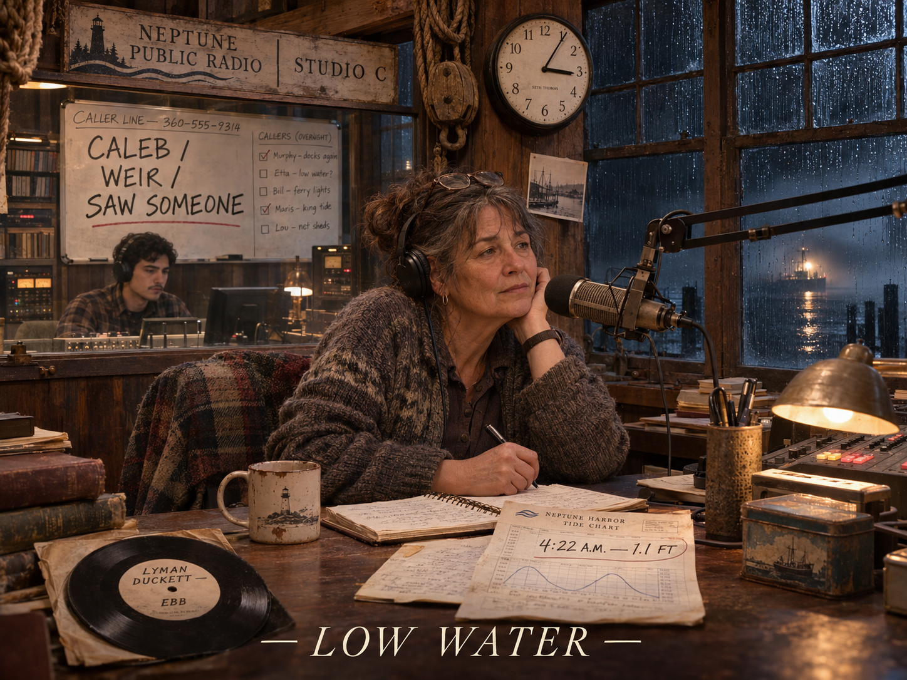

# Low Water — Program Bible

Neptune Public Radio's late-night call-in show, a fixture of the Greater Neptune Region. Program Bible v1.1, November 2026.

Companion to *The Greater Neptune Region, Master Reference v2.0* and *Mrs. Birdsong, Character File v2*

*Studio C a little after three on the morning of November 18, 2026, with Caleb on the board. The whiteboard's phone number and overnight list are set dressing. The call line is 541-LOW-TIDE.*

## Status

**Established.** The Master Reference fixes five things. *Low Water* is Neptune Public Radio's late-night call-in show. It first aired in 1979 and has run under a series of hosts. People call about road closures, lost dogs, things they saw on the Causeway at 3 a.m., and once in a while something nobody can account for. The host never laughs at a caller. Anybody driving at night in the region has heard it. Mrs. Birdsong's character file adds a sixth: among the things she likes is *Low Water* on the radio at 2 a.m.

**Adopted.** Everything else in this bible is new development, adopted as canon for the region. Where residents or callers believe something the bible doesn't confirm, the text says so.

**Held.** The region's sealed questions stay sealed: the Causeway's second explanation, what lies inside the Nation's restricted-disclosure parcels, what the Singee call Mrs. Birdsong, whether Masirua has a face, who Mr. Birdsong is, and who took the Golden Hour photograph. So do the four held answers of *The Tithe*. *Low Water* touches these only the way the region does, as things callers sometimes bring up and never get answered on the air.

**How it travels.** The show is a fixture, so any story in any town can have a radio on. The host and the regular callers are voices in those stories, heard and never met. Their own lives belong to this bible and to any story written about *Low Water* itself.

## 1. The Listening Experience

### The first thing you hear

Before the host says a word, you hear the room. *Low Water* comes out of Studio C at the back of Neptune Public Radio's building on the old riverfront in the city of Neptune, two blocks from the brass plate at Mile 0. Studio C was the rope loft when the building was a ship chandlery. It sits on pilings over the river, and the microphones pick up what the building does: a long creak when the tide pulls at the pilings, a buzz in the window glass when a ship goes down the channel, and on foggy nights the horn at the Choke, low and patient, sounding every thirty seconds under everything. Coast listeners can tell the weather at the harbor from the horn alone. People inland hear it as part of the show and think of it the way you'd think of a clock in somebody else's kitchen.

Then the theme. It's a lap-steel instrumental called "Ebb," two minutes and fourteen seconds long, recorded in 1976 by Lyman Duckett, a choker setter from Camp Nine who played Hawaiian steel guitar at Grange dances and paid a Eugene studio to press three hundred copies of a single. The founding host found one in the station's donation crate. It's slow, a little out of tune on the high string, and it sounds like water going back over gravel. Every host has talked over its last forty seconds. Duckett died in 1990. His granddaughter in Loki's Weir gets a royalty check from the station every January for about forty dollars and calls the show once a year to say she got it.

The first words have been the same shape since 1979: the time, and the next low water at the Choke.

> This is *Low Water*, on Neptune Public Radio. It's midnight. Low water at the Choke comes at 4:22 this morning, one point one feet. The bar's restricted for small boats. If you're crossing, wait. If you're driving, call and tell me where you are.

Nobody inland needs the tide. They'd notice if it were missing.

### The shape of a night

The show runs four hours, midnight to 4 a.m., and the hours aren't alike.

The midnight hour still belongs to the evening. Swing shift lets out at the cannery and the mill in Sweetbriar and the hospital in Cadence. Parents are up with a baby who won't settle. People who meant to go to bed an hour ago are still at the table. The calls are chatty and practical, roads and dogs and somebody's opinion of the weather.

From one to two the drivers take over: tanker and log trucks, the night freight out of Amity Gate, people driving home from somewhere they didn't want to be. At two comes Who's Up, and then the bars let out at two-thirty and for about twenty minutes the board fills with people who should not be on the radio. Handling that is the call screener's job, and he's good at it.

From three to a quarter to four is the deep stretch. The region is as quiet as it gets. Kitchens are dark, the trucks are spread thin on the Causeway, and the callers are the ones who are truly alone with something. Regular listeners believe this is when the strange calls come. The screener's call logs show no such pattern. The host refuses to keep count.

The last fifteen minutes belong to the morning. Crab crews are driving down to the harbor, a baker in Amity Gate has the first trays in, a dairy in the Waist is milking. The host reads the low water time again, and for anyone near the coast it's now close enough to matter.

### Music

One record an hour, chosen from postcards. Listeners mail requests to the station on postcards, and a request has to come with a reason. The host reads the reason on the air. If the library has the song, she plays it. If it doesn't, she reads the reason anyway, and listeners will tell you the reasons are the best part. "For my brother, who drove this road every night for twenty-two years and never once called you, because he said you had enough to deal with." "Because my husband hates this song, and he's asleep." Nobody has ever requested "Ebb."

### Silence

Most stations treat silence as a failure. Neptune Public Radio's automation has a silence sensor that switches to a backup feed after fifteen seconds of dead air. During *Low Water* the sensor is set to forty-five seconds, and the engineers call that setting "the Winnie," after the current host. She lets a caller stop talking. She doesn't fill the gap. The station's record is forty-one seconds, in 2019, a man calling from a pullout who couldn't get the next sentence out. She waited. When he finally spoke, she said, "Okay. I'm still here," and he went on.

### Weather and the tone

The National Weather Service's warnings break in on their own. The alert tone cuts across whatever is happening, a caller mid-sentence, a record, the host laughing, and the machine voice reads the warning. Callers on hold stay on hold. When it's over, the host picks up exactly where the tone found her: "Sorry, Sweetbriar. You were telling me about the fence." Advisories that don't trigger the tone she reads herself at the top of the hour, along with the Authority's road closures, in a section called the Board.

### Three places to hear it

**In a kitchen.** A radio on the windowsill over the sink in Sweetbriar at twenty to three. A woman up with a teething baby walks the length of the kitchen and back, and outside the flume hums the way it always does. She has never called and never will. She knows the regulars better than they know each other. She knows the tanker driver's deer count and the tow driver's daughter's major and the old beekeeper's opinion of blue hive boxes. What the show gives a kitchen is the sense of the whole region awake around you, trucks moving on the Causeway, a nurse on her break in Cadence, somebody at the harbor watching the bar. You're the only one up in your house and you're not the only one up.

**In a tow truck.** A wrecker idling on the shoulder with its amber lights turning over the ditch. Two radios are going: dispatch on the dash, sharp and clipped, and *Low Water* underneath it, low. Tow drivers listen for two things, the Board, because a closure up the road is their next call, and the human sound between the dispatch squawks, somebody talking at length about nothing much while you wait for the trooper. Sometimes the tow driver is the one on the Board.

**On an empty road.** The Causeway at 3 a.m., eastbound out of the Coast Range. The signal hands off from the transmitter on the ridge above Loki's Weir to the translator at Amity Gate, and at the summit of the Lake Creek route there's a cut where neither reaches. For about ninety seconds there's nothing but hiss. Regular drivers know exactly where it is and brace for it. You lose the end of a call, and when the sound comes back it's a different caller in a different town. You never find out how the first one ended unless you phone the station afterward, and almost nobody does. "Lost at the cut" has become a regional phrase for a story you'll never hear the end of and decided not to chase.

Night drivers learn the shape of a road in the dark, every curve, so the road ahead can disappear and they still know where it bends. Long-time listeners know the region the same way, by sound. A Sweetbriar caller has the flume under her voice. A coast caller has wind on the phone. Cadence comes in clean and close. The Wilds come in thin. The Rim comes in barely, and the Rim never lets the show forget it.

## 2. The Host: Winnie Kask

### Who she is

Winifred Ann Kask, called Winnie by everyone, fifty-eight, born in March 1968 in Loki's Weir, where she still lives. She has hosted *Low Water* since September 2012. Before that she sharpened saws, knives and scissors for a living, and she still does, three afternoons a week, in a shop behind her house with a hand-lettered sign: KASK SHARPENING, SAWS KNIVES SCISSORS MOWER BLADES. Fallers from Camp Nine bring her their chains. Every barber on the coast sends her their shears. Two restaurants in Neptune and the cannery send knives by the box.

Her father, Tom Kask, was a deckhand on the pilot boat at the Choke for thirty years. She grew up hearing bar reports the way other children heard the weather, and she knows in her body why the ebb is the dangerous tide. Her mother kept the books for a marina. Both are gone, at ordinary ages, of ordinary things.

She's married to Deb Halloran, sixty-one, who skippers a forty-six-foot crabber called the *Marguerite* out of the Neptune harbor. They've been together since 1999 and married since 2015. From the December opener through the spring, Deb is gone two and three days at a time, and Winnie's attention to the bar report is not professional. Right now there are crab pots stacked in their yard like a fort, and Deb is in the shed every evening rigging line.

### Her days

She leaves the studio at four, gets home to the Weir about ten to five, and eats smoked oysters on toast standing at the counter while she reads the coming day's tide table the way other people read their horoscope. She sleeps from half past five to one behind blackout curtains Deb cut from an old canvas boat cover. Afternoons are the shop. Evenings are supper with Deb when she's home, or alone with the television when she isn't. She leaves at a quarter to eleven for the forty-minute drive down the river to the city.

She drives a 2011 minivan she bought from the Loki's Weir Lutheran church when they replaced it, with a sliding door that no longer slides. She refuses to name it. "It's a van." Listeners have been naming it for her for years, and she reads their suggestions on the air with no intention of using any of them.

### Her ear

Twenty-five years at a bench grinder, most of them before she wore muffs, took most of the hearing in her left ear. She works with the left cup of her headphones pushed back behind her ear so it won't press, and everything comes in on the right. It means she mishears. It means she says so. It's become the backbone of how she talks to people: "Let me tell you what I heard, and you tell me if I heard it right." Callers who've been on the show a dozen times still slow down for her without being asked. People who've never met her picture her with her head tipped to one side, and they're right.

### How she runs a call

She asks where you are before she asks anything else, a town, a milepost, a pullout. Then she asks what's going on. Then she repeats it back. Then, before anything else, she asks one practical question: Have you got gas? Are you warm? Is somebody expecting you? Does anybody know where you are?

She calls people by their town. "Sweetbriar, you're on." She is terrible with names and good with voices, and she'll recognize a caller from four years ago by the way they say hello. Regulars get their names.

She never tells a caller what they saw. She never tells them they didn't see it. When a call goes strange, she does the same three things every time. She asks them to tell it again, slower. She asks about the ordinary details around it: what time it was, whether the heater was on, what they'd been thinking about before, where they were headed. And she asks the practical question again. She never asks whether they were scared. If they want to say so, they will.

The rule against laughing she keeps by a rule of her own. She'll laugh when the caller laughs first. If somebody's telling a story on themselves and she's dying, she says, "You first," and when they crack, she goes. Callers know this. If you want Winnie Kask to laugh, you have to laugh at yourself. When something truly gets her and the caller isn't laughing, she reaches for the cough button, which kills her microphone, and the board operator watches her shoulders shake behind the glass while the caller talks on, unaware.

### When she doesn't know

She says, "I don't know." Then, most often, she says, "Anybody out there know?" and the region answers. A retired highway engineer explains the culvert. A woman in Wrack says the drift board had a set of truck keys on it Monday. A long-haul driver says the scale at the Waist has been closed since Thursday. The show's whole design, going back to its first night, is that the host doesn't have to know. Somebody listening does, or nobody does, and either way it gets said on the air.

### Humor

Dry, coastal and mostly about herself: her van, her ear, her inability to work the phone system, the fact that she has spent fourteen years talking to strangers in the dark for a living and still can't make small talk at a funeral. She keeps track of things and reports the numbers deadpan. She has been on the air for something over three thousand four hundred nights, and she knows the exact figure and won't say it, because Deb told her it was the saddest number she'd ever heard.

### What she's bad at

Her hearing, obviously. Endings: she lets calls run long, and the board operator makes a winding motion through the glass that she pretends not to see. The South Divide, which she doesn't know the way she knows the coast and the Causeway, and she says so, and southerners correct her with pleasure. Politics, which she keeps off the air clumsily and sometimes sharply. Technology, any of it. Management, whose memos she reads aloud on the air when she's in a mood. She has no gift for comforting people in the usual way. She doesn't say the soothing thing. She asks if you've eaten.

She's not wise about the region. She's a woman from the Weir who listens hard. When something on the line is beyond her, she lets it stay beyond her, and that's most of why people trust her.

### Why she does it

Partly money. The station job carries health insurance, and a crab boat doesn't. That's the plainest reason, and she'll give it if asked.

Partly February 1996. During the flood she phoned the show from her father's porch in the Weir to report how many steps the water had climbed, and the host kept her on as "the Weir" for three nights. She remembers what it was like to be stuck in a house with the river at the door and a voice on the radio that knew where you were. Her father listened every night of his retirement and called exactly once, in 1988, to tell the founding host she'd read the wrong tide time. He was right. Winnie tells that story maybe once a year.

And partly, though she wouldn't put it this way, because she likes being awake when everyone else isn't. A sharpener works by sound and feel: you listen for the edge coming true. She'll tell you the job is the same.

### How she sounds

> Okay. Five Fords. You're on the bridge, the old one, and the light's out, and you can't tell if that's a person or a post at the far end. Is that what I heard? Okay. Are you in your car? Good. Stay in your car. Turn your brights on for me. Now tell me what you see.
>
> No, I don't know. I've been doing this fourteen years and I don't know. Anybody out there know why the Waist smells like burnt toast every October? Somebody does. Call me.
>
> You first. ... There it is. Okay, now I can.

## 3. History and Operation

### The first night

In 1979 Neptune Public Radio signed off at midnight like most public stations and ran an automated overnight feed. The one person in the building was the overnight board operator, Ione Tillotson, thirty-one, from Coos Bay. She was paid to babysit the automation and read the Coast Guard's marine forecast and bar conditions at the top of each hour, because the harbor pilots had asked for it. The phone in Studio C existed so the pilots could reach her.

One night in May a log-truck driver dialed it by mistake, looking for the highway department, and asked her whether the Causeway was open at the Weir. She didn't know. She put him on the air, because she figured somebody listening would. A woman in Loki's Weir called four minutes later to say she could see the road from her front window and it was open, and the water was up to the guardrail but not over. Nobody wrote down her name. That's the founding story, and it matters: the first call was a question the host couldn't answer.

The calls kept coming. By July the station manager had given the overnight a name and a slot in the program guide.

### The name

When the manager asked what to call it, Ione was reading the tide table for the bar report, and she said "Low Water," because it was the next line on the page. That's what she always said, anyway.

Residents believe other things. Some say it's named for the hour when the Choke goes quiet. Some say it's named for the drowned town at the Sump, which comes up into the air in low-water years. In the 2000s the station's own promotional copy called it "the show for when you're at your lowest," which Ione, retired by then, called the worst thing anyone had ever done to her.

### The rule

The rule against laughing is Ione's, and it was never about the strange calls.

In the fall of 1980 a boy from Sweetbriar, maybe fourteen, called to say his dog had come home. The dog had been gone over a year. The boy was crying so hard he could barely get it out, and partway through he said the dog had come back "fat, like somebody fed him," and Ione laughed, because it was funny and because she was moved and the two came out together. The boy hung up. She spent eleven nights asking on the air for him to call back. On the twelfth night he did, and she apologized, and he told her the rest, which was mostly about the dog.

After that she didn't laugh at a caller again, and she made every board operator and fill-in host promise the same. It passed down as the show's one rule. People outside the region assume it's there to protect the callers who've seen something unexplained, and it does protect them. But it started with a crying boy and a dog.

### The hosts

**Ione Tillotson, 1979 to 1994.** A low voice with a Coos Bay vowel in it, patient, a little formal. She built the show's habits: the low water time, the postcards, letting people talk. Her great run was the Nine-Week Winter of 1993, when snow shut the pass and phone service across the crest came and went. For nine weeks *Low Water* carried messages between Cadence and the west side. People in Cadence called whenever they could get a line and asked Ione to tell somebody in Five Fords or Amity Gate that they were all right, that the heifer had calved, that the pipes had held. She read every one. That's where the Messages come from. She left in 1994 to care for her mother and died in 2011, a few months before the show nearly lost itself. Her obituary in the Neptune paper ran under the headline "Go On Home," which had been her sign-off.

**Royce Mabry, 1994 to 2011.** A former state highway plow driver from Cadence, twenty years on Santiam Pass, with a big voice and every milepost on the Causeway in his head. He started the Board. He's the one who began calling people by their town. His legend is the flood of February 1996, when the Waist went under and the Neptune ran north for three days. He stayed on the air through four nights and most of the days between, sixty-one hours in all, tracking the water by caller reports from porch steps and bridge railings, one of them a young woman in the Weir counting her father's steps. He retired in 2011 with bad lungs. He's eighty now, lives in Cadence with an oxygen concentrator, and every February 7 he calls the show to give the same report: "Water's down." Winnie thanks him, and that's the whole call.

**The fourteen months, 2011 to 2012.** After Royce, the station hired Garrett Pace from a commercial station in Portland to "grow the audience." He renamed the show *Low Water: Strange Nights* in the program guide, added a sound-effects library, and courted paranormal calls. On his forty-first night a man from Five Fords called to say he sometimes heard his late wife's sewing machine running in the spare room after midnight. Pace played a theremin sting and laughed. The station got more calls the next day than in the previous year, and none of them were about roads. Three underwriters pulled out. In August 2012 the board ended the experiment. The region still says "Don't Pace it" to mean don't cheapen somebody's story.

**Winnie Kask, since September 2012.** When the station went looking for a host, the manager phoned Royce, and Royce said, "Get the Weir." Winnie had been calling a few times a year since 1996. Her audition was one live night with Royce listening in his truck in a Cadence parking lot. Afterward he called the request line and said, "She'll do," and hung up.

### The station

Neptune Public Radio began in 1968 as the educational FM of the Neptune city schools and became an independent community licensee in 1978. Its translator network was built between 1978 and 1983 with corridor-infrastructure money from the newly chartered Bioregional Authority, because the charter required emergency broadcast coverage along the Causeway. So the public register's explanation of why *Low Water* reaches most of the region is a paragraph in a 1977 statute about emergency communications. The building is the old Harbor Chandlery on the riverfront. Locals call the station "Neptune Public" or "the public station." Saying "NPR" in the region causes about one misunderstanding a week, since it means the national network everywhere else and Neptune Public Radio to anyone over sixty.

The scale is small. Two people are in the building during the show. The station's last survey estimated that about eleven thousand people hear some of *Low Water* in a given week. In a region of 556,753 that's a modest number, and it matches what everyone means when they say they've heard it at least once.

### Schedule and reception

*Low Water* airs live from midnight to 4 a.m., Sunday night through Thursday night, which the program guide lists as Monday through Friday mornings. On Friday nights the same slot carries *Low Water Rewind*, the best calls of the week, cut together by the board operator. Regulars listen to hear themselves, and a few call the following Monday to correct what they said. Saturday nights carry the national overnight service.

The main transmitter stands on the Coast Range ridge above Loki's Weir. Translators carry the signal to Amity Gate, Five Fords, Cadence and the Wilds, with low-power repeaters filling the gaps. The dead spots are part of the culture. There's the cut at the top of the Lake Creek route. There's the narrow stretch of the Rainbelt above Five Fords where rock walls swallow the signal. The South Divide gets it thinly, and Fold Creek gets it only from the ridge road. The Rim gets it worst of all, faint and fading, and Shale's callers complain about this on the air whenever they can get through. The upper South Santiam canyon gets it from a low-power repeater on the canyon's north wall, clear in the open stretches and gone at the narrows.

On the night of the Labor Day Fire in September 2020, the Five Fords translator burned a little after 1:30 a.m. Winnie went on reading evacuation routes from the Authority and the sheriff, road by road, to the people of Five Fords and Sweetbriar for another three hours. She didn't learn until six that morning that much of the Rainbelt had stopped hearing her. The translator was rebuilt in 2021. She has never talked about that night on the air except once a year, on the fire night described under Features.

### Staffing

**The host.** Winnie.

**The board operator and call screener.** Joaquín "Kino" Benavides, twenty-six, also one of the regulars, with his own entry under The Regulars.

**The engineer.** Pat Reinholt, sixty-seven, lives four blocks from the station and comes in when something breaks, which in a big storm can mean three in the morning in a rain jacket over pajamas.

**The station manager.** Carol Penhallow, who works days, sends memos, has never once heard the show live, and is fond of Winnie in the way of someone who has decided not to understand her.

### How a call reaches the air

The number is 541-LOW-TIDE, and everyone in the region knows it the way they know their own. Kino answers: "*Low Water*, where are you?" He writes each caller on the whiteboard facing Winnie's chair, in block capitals big enough for her to read without her glasses: first name, town, milepost if there is one, and three words on what it's about. TANKER / SUMMIT / CHAINS. LOST DOG / SHALE. SAW SOMETHING / WEIR. Two lines, six slots on hold. Calls go out on a seven-second delay, and Kino's thumb lives on the dump button between two-thirty and three.

Winnie chooses from the board. Road information first, because somebody is driving into it. Then whoever has waited longest. Then whoever sounds like they need it, which is a judgment she and Kino make together through the glass with their eyebrows.

There's a text line, added in 2014. Winnie hates reading texts aloud, so Kino reads them in his own voice, and younger listeners consider this the best part of the show.

### House rules

First names only unless the caller insists. No home addresses, so lost-dog callers give the road, never the house. No medical advice; callers who need it get the regional nurse line. Nothing about the Causeway's "real" reason or where the restricted parcels are. Theories about either get a polite "I'll take your road report" and nothing more. No politics beyond roads, weather and high school sports, a rule broken nightly by one caller on the subject of basketball referees.

## 4. The Regulars

### Merle Gaskins

Sixty-three, drives a fuel tanker between the depot in Amity Gate and the stations in Cadence, five nights a week, over the pass and back. He calls from the chain-up area below the summit with the pass report, and his report is better than the Authority's and he knows it. Temperature, what the snow is doing, whether it's sticking to the road or only the shoulders, whether the chain controls are up. He keeps a running count of every deer he's seen on the Causeway this year, tallied in grease pencil on the inside of his driver's door, and he reports the number every time he calls. He's at 412.

He was a Royce caller first and tested Winnie hard for her first year. He calls her "Weir." She calls him "the mountain," as in "the mountain's on line two." He's married to Darla, who runs a quilt shop in Cadence and has never once listened. She says she hears enough of him. His son is a lineman in Bend. His granddaughter shows a goat at the county fair, and the goat's progress is a regular feature of his calls whether anyone asks or not.

He listens because the pass at two in the morning is the loneliest place in the region, and because he'd rather argue than fall asleep. He argues mostly with Yoli.

### Albertine "Bertie" Nakamura

Eighty-eight, a beekeeper on the benches out past Shedd in Honey Hills, where her family has kept hives since 1946. She was four in 1942 when her family was taken from their farm near Gresham and sent to the camp at Minidoka. They came back to Oregon after the war, bought forty hives from a man who was leaving the valley, and stayed. She doesn't talk about the camp on the air. She's mentioned it twice in forty-seven years, both times in passing, and both times the switchboard lit up for an hour afterward with people who just wanted to say something.

She has called since the first summer, 1979. She knew Ione's voice before anybody. Every autumn she calls on the first night of frost on the benches, reports the date and what the bees are doing, and enters it in what she calls the Frost Book, a ledger of first frosts going back to the show's first year. The region treats her call as the official start of winter. People in the Waist plan their bulb planting around it, which Bertie finds ridiculous.

Her husband Hank, ninety, is deaf as a post and sleeps through everything. She's up at three anyway to feed the woodstove. Her granddaughter runs the bee business now and has started painting the hive boxes blue, which Bertie reports on, in detail, as a moral failing. She corrects the host's pronunciation, her grammar and her taste in records. She is unmistakably fond of Winnie and shows it entirely through complaint.

### Yolanda "Yoli" Pruneda

Forty-four, owns Pruneda Towing in Sweetbriar, two trucks and a yard beside the flume. She calls from scenes while she waits for the trooper, and you can hear the flume and the amber flashers ticking behind her. She's quick, funny, and as close to profane as the delay allows. Her running feature is the Curve List, her personal ranking of the worst curves on the Causeway, revised whenever a curve earns it. Merle disputes every revision on principle.

She lost her house in the Labor Day Fire and lived eighteen months in a trailer on her own lot while she rebuilt in the same spot. She will joke about anything on the air except that. Her daughter Lupe is at the state university in Corvallis studying to be a large-animal vet, and Lupe's midterms, Lupe's roommate and Lupe's opinions about her mother's driving are well known to the region. She coaches Sweetbriar's girls' softball in the spring.

She listens because she spends a lot of nights alone on a shoulder next to a crumpled car, and dispatch isn't company. Once, in 2018, she pulled Merle's pickup out of a snowbank near Lake Varuna on his day off. He paid her in huckleberry jam, which both of them still bring up as evidence.

### Vernon Hale

Seventy-three, Singee, enrolled in the Nurven Nation, retired after thirty-one years on the Nation's roads crew, most of them grading Fold Creek Road. He lives in East Wild with his wife Anita, who runs the senior meal site, and four grandchildren within a mile. He listens in his garage while he refinishes chairs, a habit left over from snow nights on the road crew.

His first call was in 1983, to correct the way Ione said "Singee." She thanked him on the air and said it right from then on, and he still mentions that she was the first person on the radio who did. He calls about the Wilds girls' basketball scores, the condition of Fold Creek Road, the Blazers, and referees, at length. He's the best storyteller among the regulars, about ordinary disasters: his brother-in-law's boat, the winter the meal-site freezer died with forty turkeys in it.

When a strange call comes in from the South and the board lights up with people wanting Vernon to weigh in, he doesn't. If Winnie asks, and she's learned not to, he says, "I called about the game, Winnie." The show treats that as a decision. It is one.

He and Bertie have never met. Every Christmas she sends a jar of honey to the station marked FOR VERNON, and Kino mails it on to East Wild.

### Desirée "Dez" Ambler

Thirty-one, a respiratory therapist on the night shift at the medical center in Cadence. She calls from the ambulance bay on her break, usually around ten past three, sometimes in scrubs with a coat over them in the snow. Her grandfather listened under Royce. She started listening ironically in school and is now as sincere as anyone on the show, which she resents.

She's fast and funny and uses the text line as often as the phone. Her running feature is the Soup Report, a nightly review of whatever soup the hospital cafeteria left out for the night shift. Merle calls her "Doc," and she corrects him every time: "Therapist." It's one of the region's most reliable exchanges.

She never talks about patients. That's her hard line. On a bad night she doesn't call. She texts a song request with no reason attached, and long-time listeners know what that means. Winnie plays it, and doesn't say anything about it.

She and Kino flirt on the air in a way the whole region follows closely. Neither has ever said anything that couldn't be taken as a joke. Bertie has opinions.

She lives with two roommates and a three-legged cat, climbs at Smith Rock on her days off, and is paying down her student loans at a rate she reports with grim precision.

### Joaquín "Kino" Benavides

Twenty-six, the board operator and call screener since 2021, a sound-engineering student at the community college in Neptune who plays bass in a band called the Jetty Rats. His father packs fish at the cannery. Kino answers every call, writes the whiteboard, works the delay, cuts *Rewind* on Friday afternoons, and reads the texts in a voice so flat it's become a style.

He's the one who calls the county non-emergency line when a caller sees something on the road and doesn't want to call it in themselves. He keeps the call logs, and he's the one who knows the logs don't show strange calls clustering after three. He believes the strange calls are mostly people tired and alone on dark roads. He also keeps a separate page in the back of the log, in pencil, of the calls that don't fit, and he has never shown it to Winnie.

Callers trust him. Winnie trusts him with the board, which is more.

## 5. Features, Reputation and Running Jokes

### The running order

The night runs to a pattern regulars can set a clock by. Midnight brings "Ebb," the low water time and the bar conditions, and then the first Board. Calls run until one. At the top of each hour there's another Board. At half past one comes the postcard record, except on Thursdays, when it's the Drift Report. Who's Up is at two. The Messages are at half past three. At five to four comes the close: the low water time again, the sign-off, and "Ebb."

### The Board

Started by Royce. At the top of every hour Winnie reads the Causeway by milepost from harbor to Rim. The working marks every regular knows: Mile 0 at the harbor curb, the Weir at about 15, the Lake Creek summit and the cut in the 30s, Amity Gate at about 60, Sweetbriar around 90, Five Fords from about 105 to 120, Lake Varuna around 140, the pass summit near 150, Cadence in the low 160s, and the Rim sign at about 180. After the Causeway she reads the other highways, 101, 22, 20 over the pass, and 58 through the South, from the Authority's corridor desk feed and the Weather Service. Then she adds what callers have reported, always labeled as theirs: "Merle says it's sticking at the chain-up." "A caller near Sweetbriar says there's a mattress in the westbound lane at 88." The Authority finds that the show's caller reports come in faster than its own and has written the station two letters about it, which Winnie has read on the air.

### Who's Up

Five to eight minutes at two o'clock. Callers say their first name, their town, and what they're doing awake, one line each, no conversation. The cleanup crew at the cannery. A dairy milking in the Waist. A baker in Cadence. A security guard at the grain elevator. A volunteer at the Ichabod's Eye keeper's house, who once reported the beam's count and has done so every night since. A mother up with a croupy toddler. It started in 2013, when a woman on the cannery cleanup crew called to say nothing except that she was up, and Winnie asked who else was. Long-time listeners say it's the best eight minutes in radio, and they say it the way people talk about a hymn.

### The Messages

Ione's, from the Nine-Week Winter. Listeners leave voicemails for someone else who's listening, and Kino plays three or four at half past three. "Ray in Shale, the heifer calved. It's a bull, sorry." "Mom, I got the job. Go to sleep." Kino screens every one. Anything that sounds like a threat, or like someone trying to reach a person who doesn't want to be reached, never airs.

### The Drift Report

Thursday nights. The postmaster at Wrack sends the station a list of everything pinned to the drift board that week: keys, a child's sandal, a dog tag, a wedding ring, letters that went into the river a county away. Winnie reads the list plainly. Owners sometimes call in, and some of those calls are among the best the show has ever aired. It's a list read aloud, nothing more. Nobody on *Low Water* says why things end up at Wrack.

### The Frost Call

Bertie's, every autumn since 1979. Her entry under The Regulars has the details.

### The Flood Call

Royce, every February 7. "Water's down."

### The fire night

On the first show after the Labor Day Fire anniversary procession each September, Winnie doesn't take calls for the first fifteen minutes. She reads the roads that were closed on the night of the fire, in the order they closed, the way she read them that night. Then she plays nothing for a full minute. The silence sensor is switched off for it. Then she says, "Okay," and takes the first call. She never explains it.

### Print Watch

An affectionate running bit. Callers report the Golden Hour print turning up somewhere unexpected inside the region: a dentist's waiting room in Shale, the break room at the Authority counter in Five Fords, the visiting room at the county jail. Nobody on *Low Water* has ever claimed to know who took it. When someone calls with a theory, Winnie says, "That's a theory," and asks where they are.

### What the region thinks of it

Truckers, tow drivers, snowplow crews and night nurses consider it a working tool and say so. Kitchens love it and never call. A fair number of people in the city of Neptune find it hokey, the radio equivalent of a lighthouse keychain, and listen anyway when they can't sleep. The Rim thinks it's a coast show that doesn't know where Shale is, and is mostly right. Sweetbriar has a faction convinced Winnie favors Five Fords. Bar pilots dislike callers who report the Choke wrong. The paranormal groups online think Winnie suppresses the good calls, because she won't air theories, and they clip the strange ones she does air and argue about them for weeks. Teenagers post clips of her being unbothered by drunk callers, and a surprising number of them end up listening for real.

There's a generational line. Listeners over sixty consider the text line a sign of the end. Listeners under thirty consider it the only reason they ever participated. The station tried a podcast in 2019. Winnie refused to record anything for it, so it's the raw tape with a ten-second introduction from Kino, and it does better than anything else the station makes.

### Running jokes

"Which way's your water go?" Winnie asks it of new callers as an icebreaker, borrowed from the Waist. She accepts any answer. Out-of-region truckers on I-5 who stumble onto the show have given some memorable ones.

The van, and its nameless state.

Merle's deer count, and the annual argument over whether elk count. They don't, says Merle.

The Curve List.

The Soup Report, and "Therapist."

"Lost at the cut."

"You first."

Vernon and the referees.

### Things that went wrong

**The cat, 1984.** Ione's cat, which she was not supposed to bring to work, walked across the board during a call and turned on the national feed, so for nine seconds a caller from Sump Creek was talking over the BBC. The cat's name was Pilot. Older listeners still mention Pilot.

**"Ebb" every hour, 1996.** During the flood the automation failed, and Royce played "Ebb" as his station identification at the top of every hour for three days. People who lived through the flood can't hear it without thinking of water in the kitchen.

**The eleven minutes, 2003.** Royce fell asleep during a record, and the needle ran in the runout groove for eleven minutes, a soft click and hiss. Listeners called the sheriff to check on him. A deputy knocked on the studio window. Royce woke up, put the deputy on the air, and asked him about road conditions.

**The goat, 2014.** A caller in Honey Hills was mid-sentence about a lost dog when her goat ate through the phone cord. She called back from a neighbor's to finish. The dog was found. The goat was unrepentant.

**The wrong tone, 2017.** A scheduled alert test went out at 3:12 a.m. instead of midday, with a tone coast listeners associate with tsunami warnings. Nothing was wrong. Winnie spent the next forty minutes telling people to go back to bed, taking calls from people already halfway up the hill in their cars, and finding out which of them had packed the dog. It's remembered with more laughter now than it was then.

**The proposal, 2019.** A man from Sweetbriar proposed on the air to a woman he believed was listening in Amity Gate. She called in and said she'd have to think about it. Forty minutes later she called back and said yes. They come on every anniversary.

## 6. Connections to the Existing World

### The rules it keeps

*Low Water* is a fixture, and fixtures carry no town's strangeness. A caller can describe something odd in their own town, and that oddity stays where it happened. Nothing heard on the show carries one town's local strangeness into another town's story. The show never explains the deep register. The host doesn't know it, and the people who do know it don't call to explain. The forest's standing rules hold: when a call goes strange, it's a person on a road at night telling what they saw, never the forest playing monster.

The crossing rule holds too. Winnie, Kino and the regulars are voices on a radio. In any story outside *Low Water*'s own material, they're heard and never met.

### Places

**Loki's Weir** is Winnie's home, and the Causeway's head of tide is her town's business. She knows the hour when the water seems to hesitate the way she knows her own kitchen, and she has never talked about it on the air.

**The city of Neptune** holds the studio, the harbor, the Choke and Mile 0. The bar report is the show's oldest feature.

**Wrack** supplies the Drift Report.

**Ichabod's Eye** turns up nightly in Who's Up, through the volunteer at the keeper's house and the beam count.

**The Causeway's mileposts** are the Board's whole grammar.

**Amity Gate** sends the most callers. The truck stops and the I-5 seam are where most out-of-region drivers stumble onto the show.

**Honey Hills** is Bertie's, with the Frost Book and the Golden Hour.

**Sweetbriar and Five Fords** are Yoli's country and the fire's. The flume hum is audible behind Sweetbriar callers.

**Cadence** is Merle's depot, Dez's hospital, and Royce's retirement.

**The Wilds** are Vernon's. The South comes in thin.

**Sump Creek** sends the drawdown report every dry summer, a tradition from 2001, when callers phoned in each foundation of the old town as it came up into the air.

**Shale and Faust** get the weakest signal and complain the most. Faust callers are rare.

**Fold Creek** hears the show only from the ridge road. Kino has standing instructions to decline any call asking where a restricted parcel is, and the Nation's roads office sends Fold Creek Road closures to the station by email. Vernon's old crew writes them.

### Institutions

The Bioregional Authority's corridor desk feeds the Board and is dull on purpose. The charter paid for the translators. The Weather Service supplies the tone. The county sheriffs and the state police get Kino's non-emergency calls. The Nurven Nation appears on the show the way any government does: road closures, election dates, the meal site's holiday schedule, Vernon.

### Mrs. Birdsong

**Established:** she likes *Low Water* on the radio at 2 a.m.

**New rules, to protect her file:** She never calls the show. No host or caller ever describes her on the air, and she is never the subject of a call. Where she listens, and what she makes of it, stays off the page. A writer who finds her near a radio in some story can let the show be playing, and that's all.

### Mirth and *The Tithe*

Everything in this section is adopted development. None of it changes the plot, and no chapter has to use it.

**Reception.** The canyon gets the show from a low-power repeater on its north wall. It's clear on the open stretches of the Wagon Road and gone at the narrows below Payday Curve. Up on the bench at the east end of town, Springs Road included, it comes in faint and goes to hiss in hard rain.

**How the Springs uses it.** Springs people listen and almost never call. In forty-seven years the show's board has carried the Springs mostly as pass reports. That fits a town that keeps its business to itself, where nobody laughs at the joke in its name.

**Who listens in Mirth.**

- **Manny Ruiz,** Delgado Towing's night driver, with *Low Water* low under the dispatch radio, the tow-truck listening described under The Listening Experience. Hector, who dislikes chain controls, has good reason to want Merle's pass reports.
- **Jo Bellandi,** on nights in the emergency room at Santiam Canyon Hospital, keeps it on low at the nurses' station at three. Given her settled view that things that go bump in the night are usually drunk, she's the one who turns it off when a call goes strange.
- **Teo Bellandi,** who rehearses bits in other people's voices and runs a radio show for one when he's alone, does a passable Winnie Kask in the back booth, head tipped, "Let me tell you what I heard."
- **Nadine Furlong** prints what happened. *Low Water* airs what people say happened. She regards the show as the opposite of her blotter, has it on at her kitchen table on Wednesday nights while she lays out Thursday's paper, and never admits it.

Each of these is recorded in that person's own file.

**Boundaries for Mirth.** *Low Water* carries nothing about the Lucchesi woods, the game, the dead of the 1938 fire, Chiara in 1999, the 2016 search, or any Mirth event of autumn 2026. No one has ever phoned the show about any of them, and the station's tapes hold nothing of them. The Grinny Man's strangeness doesn't travel, so no *Low Water* caller anywhere else encounters anything of his.

**All Souls' night.** November 1, 2026, is a Sunday, so *Low Water* is live from midnight to 4 a.m. on All Souls' night, the hours of the holding and the 2:00 a.m. crossing. If a radio is on anywhere in a Mirth scene that night, it carries only roads, weather and ordinary calls. The show offers the household no help, and no one there calls it. Halloween night, a Saturday, has no live show.

### Held, and staying held

The Causeway's second explanation, the restricted parcels, the Golden Hour photographer, Masirua's face, Mr. Birdsong and the Singee name for Mrs. Birdsong are never answered on *Low Water*, and no host hints at an answer. Callers can raise them. The host takes their road report.

## 7. Sample Broadcast

*Tuesday night, November 17, into Wednesday morning, November 18, 2026. An ordinary night, two weeks after All Souls' and after the high school tournaments, with no Mirth callers. Illustrative new writing, not part of Mirth's chapter sequence. Gaps in time are marked.*

**12:00 a.m.**

*"Ebb" comes up out of nothing, the high string a hair flat. Under it, the window in Studio C buzzes once as something heavy goes down the channel. Forty seconds before the end, Winnie comes in over it.*

**WINNIE:** This is *Low Water*, on Neptune Public Radio. It's midnight. Low water at the Choke comes at 4:22 this morning, one point one feet. The bar's restricted for small boats tonight, so if you've got somewhere to be on the water, you don't. If you're driving, call and tell me where you are. I'm Winnie. Kino's on the board. Kino, say hi.

**KINO:** Hi.

**WINNIE:** That's the most he'll say till three. Here's your Board. The Causeway's open harbor to Rim. Fog in the Waist from Amity Gate east, the Weather Service says dense in spots, so if you're coming across the valley, it's low beams and patience. 101 is open both ways along the Fetch. 22's open to the Sump. 20 over the pass is wet, thirty-four degrees at the summit, and there's weather coming. I'll tell you more about that when I know more about it. 58 through the South is open. That's what I've got. Lines are open.

· · ·

**12:41 a.m.**

**WINNIE:** Kino's written a name on my board in very large letters, and the name is BERTIE, and under it he's written FROST. Bertie, is that true?

**BERTIE:** It's true. Twenty-nine on the porch at twelve-thirty, and white on the truck windshield. White on the hives.

**WINNIE:** Honey Hills has frost.

**BERTIE:** The benches have frost. Honey Hills is a big place. I don't speak for the people down by the elevator.

**WINNIE:** The benches out past Shedd have frost.

**BERTIE:** Thank you. November seventeenth. That's the latest since 2014. I just wrote it in.

**WINNIE:** How many years is that in the book now?

**BERTIE:** Forty-eight. Ione had me read her the first one in 1979. October the twenty-sixth, that one was. I had a much nicer voice.

**WINNIE:** You've got a very nice voice.

**BERTIE:** I've got a voice like a screen door. Don't flatter me at my age, it's a waste of everybody's time.

**WINNIE:** What are the bees doing?

**BERTIE:** They're in their cluster. I went out with the flashlight and put my ear on the box, the third one, the one that gave me trouble in August. They're humming like a refrigerator in another room. Low and even. That's what you want.

**WINNIE:** That's a good sound.

**BERTIE:** It's the only good sound in November. Except you, I suppose.

**WINNIE:** I'm going to put that on my tombstone.

**BERTIE:** You'll put it on a blue tombstone, the way things are going. Did I tell you what she did with the new boxes?

**WINNIE:** You did. On the air. Several times.

**BERTIE:** She painted the supers to match. Blue. Like a swimming pool. My father would get out of the ground.

**WINNIE:** Is Hank up?

**BERTIE:** Hank is asleep. Hank was asleep for the Columbus Day Storm with the windows coming in. Hank will be asleep for the Second Coming, and they'll have to come back. How's Deb's boat?

**WINNIE:** She's got the pots stacked in the yard. It looks like a fort. The neighbors' kids think we're expecting an attack.

**BERTIE:** Well. Tell her to wait on the bar.

**WINNIE:** She knows.

**BERTIE:** Tell her anyway. That's what you're for.

**WINNIE:** I'll tell her. Thank you, Bertie. Everybody, that's winter. Plant your bulbs or don't.

**BERTIE:** They don't have to plant on my account. I've never told anybody to plant anything.

**WINNIE:** Goodnight, Bertie.

**BERTIE:** Mm.

*She's gone. Winnie lets it sit for a breath.*

**WINNIE:** Forty-eight years. Okay. Line two.

· · ·

**1:52 a.m.**

**WINNIE:** Kino's got YOLI / 97 / DEER on the board, which is three of my least favorite words together. Yoli, where are you?

**YOLI:** Ninety-seven eastbound, just past the hydro road, between Sweetbriar and Five Fords. You can probably hear the flume.

*You can. A low electrical hum, and the tick of her flashers under it.*

**WINNIE:** I can hear it. What've you got?

**YOLI:** Little silver Camry nosed into the ditch on the river side. Doe ran out, she swerved, she missed the doe, she did not miss the ditch. Car's done for tonight. Driver's fine.

**WINNIE:** She's fine?

**YOLI:** She's sitting in my cab with the heater going and a granola bar. She's a nursing student, she's driving back from clinicals in Cadence, she says she's not crying, she's cold. I'm waiting on the trooper so I can winch her out without the trooper yelling at me.

**WINNIE:** Is the doe okay?

**YOLI:** The doe is fine, Winnie. The doe is somewhere in the trees laughing at all of us. Tell Merle that's one for his door if he wants it. He doesn't get to count it, it's mine, but he can look at it.

**WINNIE:** I'll tell him. Does your driver want to say anything to anybody?

**YOLI:** Hang on. Hey. You want to say hi to your mom? She's on the radio, you're on the radio. Here. You just talk.

**NURSING STUDENT:** *(close to the phone, a little too loud)* Hi, Mom. I'm okay. I'm in a tow truck. The car's in the ditch but I'm okay. Don't drive out here, it's foggy. I'll call you when I get to Yoli's.

**WINNIE:** What's your name?

**NURSING STUDENT:** Kaitlyn.

**WINNIE:** Kaitlyn, have you eaten anything besides that granola bar?

**NURSING STUDENT:** ...No?

**WINNIE:** Yoli, feed her.

**YOLI:** I'm going to feed her. I've got a whole bag of the little powdered donuts. My daughter's at Corvallis, I know how to do this. Okay, give me the phone back. Winnie, I'm making a change to the List.

**WINNIE:** Oh no.

**YOLI:** Ninety-seven moves up to number four.

**WINNIE:** Above the S-curve at Sweetbriar?

**YOLI:** Above the S-curve. The S-curve, you can see coming. Ninety-seven looks straight, and then it's got trees right to the line on the river side, and then it's got deer. Merle's going to call. Tell him I don't want to hear it.

**WINNIE:** He's going to call.

**YOLI:** Tell him the jam doesn't buy him a vote. Trooper's here. Gotta go.

**WINNIE:** Go. Kaitlyn, eat the donuts. Everybody, Yoli's got the eastbound shoulder at ninety-seven, so give her room, and slow down through there, the deer are moving.

· · ·

**2:14 a.m.**

*Who's Up has just ended: a cannery cleanup crew, a dairy in the Waist, a baker in Cadence, the volunteer at Ichabod's Eye with tonight's count, and a trucker northbound on I-5 who, asked which way his water goes, said, "Down?" Kino slides two printouts under the glass.*

**WINNIE:** Kino's handing me paper, which means somebody official wants something. First one's from the Authority's corridor desk. The Causeway at milepost 97 is down to one lane, flagged, for about forty minutes while they clear a vehicle. That's Yoli's Camry, so we knew that, but now it's official. Second one's from the Weather Service. Winter weather advisory for the Cascades above thirty-five hundred feet, from 4 a.m. this morning until 4 p.m. Wednesday. Three to six inches at the pass. And the dense fog advisory for the Valley Waist runs till ten. So if you were planning to drive over the mountain tomorrow, maybe don't, and if you were planning to drive across the valley in the morning, leave early and go slow. And here's the man himself. Merle, where are you?

**MERLE:** Chain-up area, eastbound, just under the summit. One forty-nine.

**WINNIE:** What's it doing?

**MERLE:** It's snowing. Big wet flakes. It's sticking on the shoulders and the guardrail, not the road yet. Road's wet black. Thirty-one on my dash. Chains aren't up yet, but they will be by five, and anybody who tells you different is selling something.

**WINNIE:** Is that your official pass report?

**MERLE:** That's my official pass report. Four hundred and twelve deer.

**WINNIE:** Yoli says there's a doe at ninety-seven you can look at but can't count.

**MERLE:** I heard. And I'd like to address the List.

**WINNIE:** I knew you would.

**MERLE:** Ninety-seven is not a top-five curve. Ninety-seven is barely a curve. The problem at ninety-seven isn't the curve, it's people driving like it's straight. That's a driver problem. You can't rank a curve on driver problems or every curve in the region's number one.

**WINNIE:** She said to tell you the jam doesn't buy you a vote.

**MERLE:** I don't want a vote. I want accuracy.

**WINNIE:** Okay. Your objection is on the record.

**MERLE:** Write it down somewhere.

**WINNIE:** Kino's writing it down. He's not. Merle, are you warm?

**MERLE:** I'm in a truck with a heater, Weir.

**WINNIE:** Have you got your chains?

**MERLE:** I've got my chains. I've had my chains since before you were on the radio.

**WINNIE:** Okay. Go slow on the way down.

**MERLE:** I always go slow. I'm hauling nine thousand gallons of gasoline. Slow's the whole job.

**WINNIE:** That's the mountain, everybody. It's snowing at the summit. Chains by five.

· · ·

**3:06 a.m.**

*The board has thinned. Kino has written CALEB / WEIR / SAW SOMEONE. Winnie looks at it for a long moment before she takes the line.*

**WINNIE:** Okay. Loki's Weir. You're on. That's my town, so I'm listening extra hard. Where are you?

**CALEB:** Hi. Sorry. I've never called before. I'm, um, I'm pulled over at the turnout just below the Weir, by the old pilings? On the river side. Westbound.

**WINNIE:** I know it. The gravel one with the pothole you can lose a tire in.

**CALEB:** Yeah. I found it.

**WINNIE:** Everybody does. What's your name?

**CALEB:** Caleb.

**WINNIE:** Okay, Caleb. You're at the turnout. What's going on?

**CALEB:** I'm, okay, I'm driving home from Eugene. My dad had heart surgery yesterday, a bypass, and it went fine, he's fine, I've just been up since, like, five a.m. yesterday. I'm going home to Neptune. My wife's home with the baby. And I pulled over here because I needed to stand up for a second.

**WINNIE:** Good. That's a good reason.

**CALEB:** And there's a guy in the river.

*A pause. Winnie doesn't fill it.*

**CALEB:** Not, like, in trouble. I don't think. He's standing in the water, maybe up to his knees, out from the bank, just below where the boat ramp is. He's got a light, a lantern or a headlamp, I couldn't tell. And he's just standing there. Facing upstream.

**WINNIE:** Let me tell you what I heard, and you tell me if I heard it right. There's a man standing in the river below the boat ramp at the Weir, knee deep, with a light, facing upstream, and he's not moving. Right?

**CALEB:** Right.

**WINNIE:** Did you talk to him?

**CALEB:** Yeah. I went down to the edge of the gravel and yelled, "Hey, you okay?" And he turned around and kind of raised his hand. Like a wave. And he said he was fine. He said he was waiting on the slack.

**WINNIE:** Waiting on the slack.

**CALEB:** That's what he said. And then he said, "Thanks for stopping." And he turned back around.

**WINNIE:** Was there a truck? Anybody's car parked up there with you?

**CALEB:** No. That's the thing. Mine's the only car. I looked up and down the road and I don't see where he came from. And I don't know if I'm supposed to call 911 on a guy fishing, because that seems crazy, and I don't want to just drive away, because what if he's not okay, and I've been up for twenty-two hours, so I thought, I'll call the radio.

**WINNIE:** Okay. You did fine. Let me ask you some boring things. What's he wearing?

**CALEB:** A coat. Dark. Waders, I think? Or jeans. I don't know. It's dark. He had a hat.

**WINNIE:** Did he seem cold?

**CALEB:** No. He seemed, honestly, he seemed like he was at work. Like I was interrupting.

**WINNIE:** Did he ask you for anything?

**CALEB:** No.

**WINNIE:** Is he still there?

**CALEB:** *(a pause, the phone moving)* I can see the light. Yeah. Same spot.

**WINNIE:** Okay. Here's what we're going to do. Kino's going to call the county's non-emergency line and tell them there's a man standing in the river at the Weir at three in the morning in November, and they can send somebody to look, and that's on us. It's not on you. You did the stopping part. That was the hard part.

**CALEB:** Okay.

**WINNIE:** Have you got gas?

**CALEB:** Half a tank.

**WINNIE:** Is anybody expecting you?

**CALEB:** My wife. She's asleep. She said text when I get to the Weir, and I'm at the Weir, so I guess I should do that.

**WINNIE:** Text her now, before you pull out. Then you drive home. It's twenty minutes. Fog's light on the river tonight. Go slow through the curves below the bridge.

**CALEB:** Okay. Thanks. Sorry. This is a weird thing to call about.

**WINNIE:** It's not, actually. You'd be surprised what's a weird thing to call about. Tell your dad Loki's Weir says get well.

**CALEB:** I will. Thank you.

*He's gone. Winnie is quiet for four or five seconds.*

**WINNIE:** Kino's on the phone with the county. Anybody who knows the Weir, I'm open.

**KINO:** We've got a text.

**WINNIE:** Read it.

**KINO:** *(flat, as always)* "Guys fish the Weir at night all the time. My uncle used to go down at the slack with a lantern. Tell the kid not to worry." That's from a listener in the Weir.

**WINNIE:** Thank you, Weir. There you go, Caleb, if you're still in range. People fish the slack. Okay. Line one.

· · ·

**3:57 a.m.**

*The Messages are done. The window buzzes once. The horn at the Choke has started up; the fog has come in off the bar.*

**WINNIE:** That's almost four. One more thing. Kino heard back from the county a little while ago. A deputy went by the turnout at the Weir around twenty to four and didn't see anybody in the water, and didn't see a light. Which could mean a lot of things, and mostly it means a man got done fishing and went home. Caleb, I hope you're asleep. Kaitlyn, I hope you ate the donuts. Merle, I hope you're down off the mountain. Bertie, I hope you went back to bed. You didn't, but I hope it.

Here's your last Board. The Causeway's back to two lanes at ninety-seven. Snow at the summit, chains by five, according to the mountain. Fog in the Waist till ten. Frost on the benches in Honey Hills, and that's winter, officially.

Low water at the Choke is at 4:22, one point one feet, in twenty-five minutes. Up at the Weir it runs about an hour behind that, so call it twenty past five, give or take. If you're out there waiting on it, it's coming.

That's the water going out. Go on home.

*"Ebb" comes up, slow, the high string flat. Under it, the horn at the Choke, every thirty seconds. Then the national feed, and the room is gone.*

## Source Note

*Kept separate from the bible. This records what was actually read in preparing it and what each reading helped with. Nothing here is canon.*

**Sarah Orne Jewett, *The Country of the Pointed Firs* (1896), chapters 6 and 7** (Standard Ebooks). Captain Littlepage's tale of the "waiting place," fog-shaped figures on an uncharted northern coast, told to the narrator in a whisper, and then the community's handling of him afterward: the narrator's quiet "Sit down, sir," her admission that the tale had "such an air of truth that I could not argue," and Mrs. Todd's affectionate worry about his "flighty spells." This shaped Winnie's whole posture toward the strange call. She attends to the person, doesn't argue, doesn't certify, and asks after the ordinary things. Littlepage himself also calls Dunnet's decline "low-water mark," which felt like permission.

**Charles W. Chesnutt, "The Goophered Grapevine," from *The Conjure Woman* (1899)** (Standard Ebooks). Uncle Julius's conjure tale arrives with an ordinary stake behind it, a vineyard he's been quietly living off, and the framing narrator can't decide whether the stake inspired the story. Annie's question, asked "doubtfully, but seriously," is very nearly the show's house manner. It also suggested giving every strange call an ordinary human reason underneath. Caleb has been up twenty-two hours, his father is in the hospital, and he doesn't know whether calling 911 on a fisherman is crazy.

**Sherwood Anderson, *Winesburg, Ohio* (1919), the opening pages of "The Teacher" and "The Book of the Grotesque"** (Standard Ebooks). The Master Reference already names *Winesburg* as the anthology model. In "The Teacher," the snow night when all but four of the town's eighteen hundred citizens are in bed, and the narrative passes from one wakeful person to the next, became the shape of Who's Up. The weeping carpenter in "The Book of the Grotesque," whose crying the old writer finds ludicrous, sharpened the founding of the no-laughing rule. It began with a crying boy, not a ghost.

**Mark Twain, *Life on the Mississippi* (1883), the ninth chapter** (Project Gutenberg text via GITenberg). Mr. Bixby's lesson that a pilot learns the shape of the river so well he steers by "the shape that's in your head," whether the night is starlit, pitch dark or gray mist. This became the night driver's knowledge of the Causeway and the long-time listener's knowledge of the region by sound.

**Charles Dickens, "Night Walks," from *The Uncommercial Traveller* (1860)** (Project Gutenberg text via GITenberg). The city's "fits and starts of restlessness" for its first two hours, the dead stretch after, when "the houseless eye looked out for lights in windows," and the rekindling at dawn with the first workpeople. This gave the four hours of the broadcast their separate weathers.

**The West, Florence, Lane County, Oregon (1890–1921)**, the real paper published on the ground the city of Neptune sits on, seen through the University of Oregon's Historic Oregon Newspapers pages in search results. Seen only in brief OCR fragments and a 2020 *Siuslaw News* retrospective that reprinted old items, not read in full. Its local-items columns from outlying settlements, "Glenada Gleaning" and "Greenleaf Items" among them, were a reminder that this coast has always had a habit of small reports sent in from hamlets: blackberries nearly gone, a lodge anniversary, a road open. Who's Up and the Board are that habit moved to the telephone.
