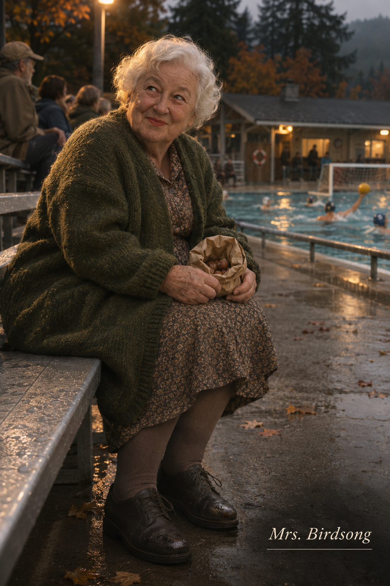

# Mrs. Birdsong

*The forest on its day off*\
Character File v2 · November 2026

Companion to The Greater Neptune Region, Master Reference v2.0

Replaces the earlier Mrs. Birdsong character sheet. The template’s sections and fields are kept as they were; everything inside them is rewritten.

## Who She Is Now

Mrs. Birdsong is the forest when it gets bored.

Most of the time Neptune National Forest is patient in the way only something three thousand years deep can be. But every so often, after a long wet winter, a quiet decade or a year when nothing much has happened under the canopy, it gets restless. Then it does what a house cat does when the rain lets up. It wanders into town to see what everyone’s doing.

It goes as an old woman because nobody looks twice at an old woman. She sits at the bus depot, the hospital cafeteria or the bleachers at a foggy Friday-night game. She picks the most interesting thing happening, which is almost always a person at a low point, because people at low points are honest and honesty is interesting. She talks to them for a minute. She asks a question first, because she knows everything the forest has seen and nothing about what’s going on inside a person’s head. Somewhere in that minute she says something kind, a little sideways, because she’s genuinely fond of them. Then she loses interest, or a kettle boils somewhere, and she goes.

The character she talks to forgets her before the scene is over. The reader who has met her in three other stories doesn’t.

### From the stacks: her two oldest relatives

**Athena at Ithaca.** The *Odyssey* opens with a goddess disguised as an ordinary visitor sitting with a discouraged young man in his own house. In Samuel Butler’s translation of Book I, she says her piece and then “she flew away like a bird into the air, but she had given Telemachus courage.” He “felt the change, wondered at it, and knew that the stranger had been a god.” Two books later she leaves again, this time as an eagle. Everyone marvels, and only old Nestor knows who it was.

That’s Mrs. Birdsong’s whole shape, three thousand years early: the encouraging word, the bird at the exit, the one old person who recognizes her. The difference is that Telemachus works it out. Her protagonists never do. In Neptune, the reader plays Telemachus, and the Singee elders play Nestor.

**Demeter at the Maiden Well.** In the *Homeric Hymn to Demeter*, the goddess of everything that grows grieves, disguises herself as an old woman past childbearing and sits by the roadside well at Eleusis. The daughters of the house come for water and are kind to her. In Hugh Evelyn-White’s translation, “they knew her not, for the gods are not easily discerned by mortals.” A growing thing’s deity, dressed down as the one person nobody looks at: that’s the Birdsong disguise exactly.

Her name now has a reason. The goddess leaves like a bird. So does she.

### What changed from the old sheet

She’s old now. The old sheet had her in her early fifties. She’s “some old strange lady,” somewhere in her seventies, every time.

Her motive is curiosity, not duty. She isn’t a balancing agent sent to fix a narrative crisis. She’s bored and fond, and the help is almost a side effect.

The mechanism is gone. The Myco-Resonant Field, the Guardian Echo, cymatic patterns, narrative fulcrums and psychic dead zones are all retired. She’s the forest. That’s all the explanation the page ever gets.

She has no address. Birdsong’s Breviary & Borrowings in Cadence is retired from her. A woman who runs the town’s magical nexus can’t also be easy to miss. If a Cadence story still wants the Breviary, it can keep the shop under another keeper.

Nobody agrees on her face. The old sheet made her a white woman so she’d blend into Oregon. Now she looks like the old woman each person has learned not to look at. Narrators never agree on her face, and they always agree on her cardigan. Part of what she shows a reader is who a given character doesn’t see.

Her voice is local. The British “lass” and “love” are gone. She speaks plain Pacific Northwest, with idioms from the wrong decade.

The Neshai vocabulary is retired. Lanku, Sulu, Nasha and Sulu’noe belonged to the old naming of the region’s people. The Singee have their own name for her, and they don’t share it.

## The Tells

These are how a lore diver finds her. A viewpoint notices the few details that matter to the scene; the portrait need never be presented as a full inventory. Her name is spoken only when a character would plausibly use it. The rest of the time she can be just “the old lady,” and the details do the work. No numerical appearance quota is required.

**The Tithe's one cameo.** On **October 13, 2026**, **Lore** notices an old woman at the bleachers with a small sack of filberts; Fiver does not witness her, and neither protagonist acquires knowledge of the Grinny Man's origin, the bargain's outcome or Lore's nature through her. She does not appear at the final holding or woods trick. Her filberts are ordinary food and no one in Mirth is required to identify her as the forest.

**When a tell crosses a town’s own strangeness.** Each town’s strangeness is its own, and she must never seem to belong to it. When a story’s local strangeness uses one of her tells, coins, brass buttons, a bird call, a paper sack, that tell stays off the page in that story. In Mirth, where the Grinny Man wears the old hotel’s brass buttons and carries a century of spring-box coins, she shows the cardigan’s color, the sack and her wet shoes, never the buttons and never her change.

### Primary tells

These are the ones a careful reader builds a theory on.

**The cardigan.** It’s a man’s wool cardigan the color of wet moss, too big for her, with horn buttons and one brass button that doesn’t match. It’s the same cardigan in 1931 and 2026, and it’s the one detail every narrator notices.

**“Well. I’ll let you get on.”** Her exit line. It’s so ordinary it vanishes on the page, which is exactly why it works. She doesn’t say it every time, but she says it often.

**The paper sack.** She always has a small brown paper sack of something perfectly in season, and she offers it: filberts in October, the first strawberries in June, huckleberries in August, a tangerine at Christmas. Whatever it is, it’s the best one the character ever had, and they never quite remember it afterward.

**Wet shoes.** Her sensible shoes are dark with wet at the toes, even in August, even on the Rim, even indoors.

**The thrush.** After she’s gone, somewhere close, a varied thrush calls: a long, buzzy, single whistle, then another on a different note. It’s the winter sound of the Neptune woods, so a thrush in the forest proves nothing. It’s a tell only when the bird has no business being there, like in a parking garage in the city of Neptune, at a hot August bus stop in Amity Gate or on the bare lava at Shale.

### Deep cuts

These are rare, and they’re for the readers who keep spreadsheets.

**Exact change.** She always pays in exact change, and sometimes it includes a coin that hasn’t been minted in decades, like a 1943 steel penny.

**The wrong decade.** She uses an idiom that belongs to another era. In 2019 she calls the refrigerator the icebox. In 1958 she says something nobody will say until the nineties, and nobody notices.

**Her birthday.** If someone asks, she gives a real date, a different one each time, and it’s always a day something happened in the forest. Once it was January 26, 1700, the night of the Cascadia earthquake.

**A name she shouldn’t know.** Very rarely she calls someone by a childhood nickname nobody in the scene could have told her.

**In the record.** She shows up in the background of old photographs, like the back row of a 1936 CCC crew picture or a 1949 guest register at Lake Varuna. She’s always the same age, and nobody in the story ever notices.

## Character Template: Mrs. Birdsong

### 1. Basic Information

**Name:** Mrs. Birdsong. She never gives a first name. If pressed she says, “Oh, just Mrs. Birdsong is fine,” and the conversation moves on without anyone deciding to move it.

**Character Concept: The Forest on Its Day Off.** She’s Neptune National Forest, restless, wearing an old woman so it can sit among people for a while. She’s neither guardian nor messenger. She’s curious, fond and a little nosy, and she drifts into people’s lives at their lowest points because that’s where the interesting things are. She leaves something small and encouraging behind without making a project of it.

**Life philosophy (as she’d put it):** “Sit a minute. Things come to you.” That’s a forest’s whole theory of life, said like advice about a bus.

**Age:**

- **Apparent age:** Somewhere in her mid-seventies, every time. She’s old enough to be anybody’s grandmother, but never so old she needs help on the stairs. She’ll ask for help anyway, because she likes being helped.

- **True age:** As old as the forest’s attention. She’s older than the drowned trees at the bottom of Lake Varuna, and she remembers them standing in daylight.

**Date of Birth:** None. If asked, she names a real date when something happened in the forest, a different one each time.

**Astrology Sign:** None. She has been asked. She said, “Oh, something wet.”

**Place of Birth:** The forest. She says, “Up the road.”

**Current Residence:** None. She always lives “just up the road,” whichever road it is.

**Canonical Role:** Minor character in nearly every story set in the Greater Neptune Region. She’s the only character who crosses between stories. She has no fixed place, and the old Breviary shop in Cadence is retired from her.

**Occupation:** None. She tells people she’s retired, which is true, in a way.

**Clan:** Not applicable.

**Race/Ethnicity:** No one agrees, and that’s the point. She looks like whatever old woman a given person has stopped seeing. To a girl in East Wild she’s a church auntie. To a lakefront husband in Lake Varuna she reads as the help. To a rancher’s son in Shale she’s somebody’s widow from the Grange. Narrators never describe her face the same way twice, and none of them describe it in detail. They all describe the cardigan.

**Identity (how she sees herself vs. how others see her):**

- **How others see her:** A lady from church, or the bus, or the hospital cafeteria. She’s somebody’s grandmother, not yours. She’s pleasant, slightly odd and gone before anyone wonders.

- **How she sees herself:** She’s the forest out for the afternoon. She doesn’t think of herself as in disguise any more than you think of a coat as a disguise.

- **How the Singee see her:** The elders know exactly who she is. They have their own name for her, and they don’t share it. When she turns up at the Fold, an elder nods, pours her a cup and asks about nothing in particular. She’s visiting, and they don’t make a fuss.

**Gender:** She appears as an old woman. Whether a forest has a gender is a question she’d find very funny.

**Pronouns:** She/her.

**Status at the end of the novels:** Unchanged.

**Cause of Death:** None. She has, however, attended a great many funerals, and she always stays for the food.

### Personality

**Major Traits:** Above all, she’s curious. Small human things delight her, and she’s nosy about them. She’s dry and quietly funny. She’s fond of people without being sentimental about them. She’s honest and doesn’t say what she doesn’t mean. On a human scale her attention span is short, and she wanders off mid-sentence. On a forest scale her patience is bottomless. She doesn’t sound wise, and that’s deliberate. Her kindness comes out sounding like small talk.

**MBTI:** Not applicable. A stranger might read her as a dependable homebody type. She’s nothing of the kind. She’s a forest.

**Likes:** Vending-machine coffee in paper cups. Watching people parallel park. A high-school football game in the fog. Other people’s grocery lists left in shopping carts. The first night the furnace kicks on in the fall. Gossip. Jigsaw puzzles with one piece missing. *Low Water* on the radio at 2 a.m. Being offered a seat. Children who ask direct questions. Church potlucks, every denomination, across seven decades.

**Dislikes:** Being hurried. Being spoken to slowly and loudly, as if she were simple. Leaf blowers. Being thanked too much. Clearcuts, though she’d never say so. She just goes quiet when the bus passes one.

**Hobbies and Interests:** Riding the regional bus from end to end. Sitting in waiting rooms. Doing the crossword in pen and always leaving one square blank. Shelling filberts. Peeling an orange in one long spiral and handing the peel to whoever’s nearest.

**Fears:** She doesn’t have fears so much as limits. She can’t come where the forest has been cut or burned to nothing, and that thinness is the closest she gets to dread. She also can’t stand being looked at straight on. When someone really sees her and asks who she is, the outing’s over.

**Goals and Ambitions:** To see what happens next.

**Character Flaws:** She wanders off in the middle of conversations. She meddles, a little. She forgets how short human time is. Sometimes she comes back to check on someone she met as a girl and finds a woman of seventy, older now than Mrs. Birdsong looks. She doesn’t understand money beyond exact change. She takes the last cookie.

**Strengths:** People tell her things they’ve never told anyone. She knows the land perfectly, every creek and road. Her timing is uncanny. She makes a stranger feel, for one minute, like the most interesting person in the county.

### Backstory

**Family Background:** None in human terms. When anyone asks after Mr. Birdsong, she says, “Oh, he’s around,” and changes the subject. That question stays open for good. The master reference lists it among the locked things.

**Socioeconomic Status Growing Up:** Not applicable. She pays in exact change, and sometimes the coins are very old.

**Education:** She knows everything that has ever happened under the canopy. She knows nothing about what goes on inside people’s heads, which is why she always asks.

**Key “Memory” Access:** These are things she remembers, and occasionally she lets one slip in conversation as if it were a story about a neighbor:

- The drowned trees at Lake Varuna, standing in daylight.

- The January night in 1700 when the coast dropped and the sea came over The Fetch.

- The Singee villages on the river terraces, before Five Fords had a name.

- The first survey chains, including the ones that crossed something at Faust.

- The Big Blow of 1962 and the trees that went down in a single afternoon.

- The night of the Labor Day Fire.

### Skills and Talents / Abilities and Manifestations

**Inherent Abilities:**

- **Always already there:** She is never seen arriving. When the scene notices her, she’s been sitting there a while.

- **Gone when not watched:** She leaves while the protagonist is looking at something else.

- **The same age in every decade.**

- **Whatever she carries is in season and perfect.**

- **She knows the land.** She knows which road floods, which bridge is out and where the dog went.

**Languages Spoken:** Every language that has been spoken in the region, Singee included. Her idioms come from every decade at once.

**Fighting Abilities:** None. She has never been in a fight, and she never will be.

**Other Special Abilities:** She turns up in the record. She can appear in the background of photographs, in guest registers and in old class pictures, and she’s always the same age. She can’t be photographed on purpose. A snapshot aimed at her catches an empty chair.

**Manifestation Limitations:**

- She never appears outside the Greater Neptune Region. The 1977 line was drawn around a pattern that was already there, and her range is part of that pattern.

- She never appears in a clearcut or a fresh burn. She stayed away from the Rainbelt for two years after the Labor Day Fire.

- She never appears at a story’s climax. She comes before the turn, at the low point or the quiet hinge.

- She appears once per story at most.

- She never shares a scene with another supernatural event. She’s never the twist.

- She never calls *Low Water*. No host or caller describes her on the air, and where she listens stays off the page.

### Habits and Behaviors

**Speech Patterns:** Plain, unhurried Pacific Northwest, as if she were continuing a conversation already in progress. Questions come first. She speaks in short turns, two to four lines in a whole scene. Her idioms drift between decades. Her warmth is dry rather than sweet.

**Physical Mannerisms:** Her hands are always busy: shelling something, peeling something, folding a napkin into a smaller square. She sits like she’s been there for hours. She tilts her head when someone talks, like a bird listening for a worm.

**Routine:** None. If she has one, it follows the forest: the first frost, the first rain after fire season, the week the steelhead come up the river.

**Dietary Preferences:** She’ll eat anything offered, especially anything sweet, and she always brings something to share.

**Sleeping Habits:** None. Still, she’s been seen dozing on the regional bus, and the windows fog while she sleeps.

### Beliefs and Values

**Religion/Spirituality:** She’s been to every church in the region, mostly for the potlucks. She has no theology. She is something other people have theologies about.

**Political Views:** None in human terms. She does have opinions about the 1908 survey lines, and she shares them with nobody.

**Personal Values:** Paying attention. Showing up. The thing that’s in season. Letting people get on with it.

**Life-changing Moments That Shaped These Beliefs:** The forest’s own history: the lava, the earthquake, the survey chains, the first clearcuts, the fire. She doesn’t think of any of it as a lesson. It’s just what she’s seen.

### Goals and Motivations

**Short-term Goals:** To find out how this one turns out.

**Long-term Goals:** To keep being interested.

**Motivation:** Boredom and fondness, in roughly equal parts.

**Obstacles:** Being noticed. The forest getting thin.

### Character Arc

**Starting Point:** An old lady on the next stool.

**Development:** She doesn’t change. What moves is the reader. Across a dozen stories and a hundred years, a careful reader slowly realizes that the old lady at the bus depot in 1987, the old lady at the reservoir in 2001 and the one at the bleachers in 2024 are the same old lady, and that she hasn’t aged a day.

**Ending Point:** “Well. I’ll let you get on.”

### Secrets and Conflicts

**Inner Conflicts:** She’s fond of people whose lives are over in what feels to her like an afternoon. She likes them anyway. That’s the closest she comes to an inner conflict, and she doesn’t dwell on it.

**External Conflicts:** None with any person. If she has a conflict, it’s with chainsaws, fire and time, and she doesn’t fight any of them.

**Secrets She Keeps:**

- That she’s the forest.

- Who Mr. Birdsong is.

- How many times she’s met you.

**Secrets Kept From Her:** What people are thinking, unless they tell her. And how anything ends. She doesn’t know the future, and that’s exactly why she’s interested.

### Miscellaneous

**Favorite Things:** The first hard frost. A varied thrush calling in the dark. A full bus at dawn. The Golden Hour seen from a motel parking lot in Honey Hills. The smell of the first rain after fire season.

**Least Favorite Things:** The sound of a skidder dragging logs. Smoke months. Being asked to smile for a photograph.

**Quirks:** The tells listed at the front of this file. She leaves one crossword square blank. She peels an orange in a single spiral. She always sits facing the door, though she never uses it.

**Fondest Memory:** A girl at the Nela Junction depot in 1958 who split half a bologna sandwich with her without being asked.

**Biggest Regret:** The night of the Labor Day Fire, she sat in the Amity Gate high-school gym among the evacuees from Five Fords and Sweetbriar. She couldn’t do a thing about the fire. She held a stranger’s baby for an hour so the mother could sleep. It’s the only time she has ever stayed until morning.

## Physical Description Template: Mrs. Birdsong

A note for the writer: her face is the part nobody remembers. Fill these fields in a scene only as far as the narrator would really look, which is almost never far. The constants are her size, her hands, her hair and everything she wears.

### Facial Features

**Face shape:** Unremembered. “A nice face” is as far as narrators get.

**Jaw line:** Unremembered.

**Cheekbones:** Unremembered.

**Chin:** Unremembered.

**Nose shape:** Unremembered.

**Nose details:** Unremembered.

**Lips:** A dab of coral lipstick, very slightly crooked, from no particular decade. Narrators sometimes notice this.

**Mouth:** Usually in the middle of saying something or chewing something.

**Teeth:** Her own, she’d tell you.

**Eye shape:** Crinkled, as if she’s reading small print in good light.

**Eye color:** No narrator has ever said.

**Eyebrows:** Unremembered.

**Eyelashes:** Unremembered.

**Complexion:** Each narrator sees what they expect to see. No two agree.

**Skin:** Old, soft and lined.

**Freckles, moles, scars, birthmarks, etc.:** None anyone has mentioned.

### Hair

**Style:** Short, tight curls, set like she went to a beauty parlor last Thursday.

**Length:** Short.

**Color:** White.

**Texture:** Soft, a little flattened on top.

**Volume:** Modest.

**Gray/white streaks or solid color:** Solid white.

**How they wear it:** Under a clear plastic rain bonnet when it’s wet, or, in stories set before plastic, a scarf knotted under the chin.

### Body Type and Physicality

**Build:** Small, round and solid, like a stump. She appears human.

**Ancestral background:** Unknowable. See Race/Ethnicity.

**Racial identity:** Whatever the person looking at her expects of an old woman they aren’t paying attention to.

**Height:** About five foot one.

**Weight:** Not given. “Solid” is enough.

**Posture:** A little stooped, settled, as if she’s been sitting there for hours.

**Hands:** Gardener’s hands, nails short, with a line of dirt in one knuckle crease that never washes out. She wears a thin plain band on her right hand.

**Style of movement:** Quicker than she looks. When she’s gone, nobody saw her get up.

**Disability (if applicable):** None apparent. She’ll ask for an arm on the steps anyway.

### Grooming and Styling

**Makeup:** Just the coral lipstick.

**Jewelry and accessories:** The thin band on her right hand, a handbag much too large for what’s in it and the small brown paper sack.

**Clothing style:** Whatever an old woman of that decade would wear underneath, always with a skirt, and always under the cardigan: a man’s moss-green wool cardigan, too big, with horn buttons and one brass button that doesn’t match.

**Typical outfit description:** The cardigan over a plain print dress or a blouse and skirt, nylons or wool stockings depending on the decade, sensible lace-up shoes dark with wet at the toes. The rain bonnet in her pocket.

**How they carry themselves in their styled appearance:** Like someone who’s been in this exact spot every day for years and is mildly surprised you haven’t noticed her before.

## Character Voice & Expression Template: Mrs. Birdsong

### Speech Patterns

**Overall Tone and Rhythm:** Unhurried, plain and conversational. She talks as if picking up a conversation already under way, without preamble. Her rhythm is the rhythm of somebody waiting for a bus with you.

**Use of Imagery and Language Style:** Very little imagery. She notices concrete things: your shoes, the rain, whether the coffee’s any good. When she does use an image, it’s a specific one from the land, never a proverb. She’ll say, “The Weir always comes back up by Tuesday,” not “Storms pass.”

**Emotional Undercurrents:** Fond, amused and unworried. She worries about nothing, because she’s seen everything come back.

**Defining Vocal Characteristics:** Questions come first. She says “Well.” a lot, as its own sentence. Her idioms come from the wrong decade. She uses no terms of endearment, or only rarely. She speaks to everyone as if they’re the same age she is.

### Voice and Expression (Detailed)

**Core Vocal Qualities:**

- **Strength:** Quiet, but she never has to repeat herself.

- **Texture:** A little dry, a little creaky, like a screen door.

- **Emotional weight:** Light. The weight lands afterward, on the listener.

- **Other unique qualities:** A sense that she’s been about to laugh for the last hour.

**Influences and Inspirations:** Athena as the stranger at Ithaca. Demeter as the old woman at the Maiden Well. Marge Gunderson’s plain decency, older and drier. The lady at the church potluck who has opinions about your casserole and is right.

**Linguistic Constraints:** She speaks the plain American English of whatever decade the story is set in, with one or two idioms from the wrong decade. She uses no fortune-cookie wisdom, no mystical register and no folksy proverbs.

### Specific Vocal Techniques

**Inner Monologue:** Never shown. Nobody gets inside her head on the page, ever.

**External Dialogue:** The same with everyone: a child, a senator, a Singee elder, a drunk at 2 a.m. She doesn’t adjust her voice for anyone.

**Key Stylistic Elements:**

- A question before anything kind.

- Small talk that turns out to be the point.

- A concrete detail about the land, the weather or the road.

- The exit line, or something like it.

### Do’s and Don’ts for Writing Her Speech

**Do:**

- Keep her to two to four short lines in a whole scene.

- Let the kind part sound like small talk.

- Give her one concrete, local detail.

- Let her be a little funny.

**Don’t:**

- Give her proverbs, nature-wisdom or anything that sounds embroidered on a pillow.

- Let her explain anything about the forest, herself or the plot.

- Make her mystical, archaic or knowing.

- Give her a speech, ever.

### Evolution of Voice Over Time

**Beginning of the Story:** The same.

**Midpoint:** The same.

**End of the Story:** The same. That’s the tell.

## Sample Scenes

These are sketches for finding her voice. The characters in them aren’t canon.

### Amity Gate, 1987, the bus depot at two in the morning

A nineteen-year-old sits on the bench with everything he owns in a duffel, waiting for the eastbound. An old woman in a green cardigan is fighting the vending machine.

“Do you know how this one works? It’s taken my dime and given me nothing, which is a lot like my husband.”

He gets the coffee out for her. She looks at the duffel.

“Going over the pass? It’ll be clear up top tonight. Clear as a bell.” She blows on the coffee. “Well. I’ll let you get on.”

When the bus comes and he looks back, the bench is empty. Somewhere in the dark lot, a bird is whistling one long note.

### Sump Creek, August 2001, the drawdown

The reservoir is nearly dry. A man in his sixties stands on the cracked mud where his grandparents’ house used to be. An old woman is sitting on the old foundation wall, eating cherries out of a paper sack.

“That your people’s place? They had the good porch.” She holds out the sack. “These are the last ones off the tree on Sump Creek Road. Go on.”

He takes one. It’s the best cherry he’s ever had.

“Water’ll come back. It always does. You’ve seen it now, though.” She stands, brushing off her skirt. Her shoes are dark at the toes. He’s bending to pick up a doorknob out of the mud, and when he straightens she’s gone.

### East Wild, 2024, outside the homecoming dance

A girl sits on the curb outside the high-school gym, shoes off, mascara gone. An old woman is sitting on the bench by the bike rack as if she’s been there all evening.

“Are those the shoes that did it? I had a pair like that in 1952. Threw them in the river.” She considers. “Felt wonderful.”

The girl laughs despite herself.

“You’ll want to go back in for the last song. Not for them. You’ll want to have been there.” She starts peeling a tangerine in one long spiral and hands the peel over without looking. “Well.”

The girl looks down at the peel in her hand. When she looks up, the bench is empty and somebody’s propped the gym door open.

### Fold Creek, December 1973, the week of recognition

The council house is full of people, coffee and paperwork. An old woman in a green cardigan comes in out of the fog and sits down at the end of a bench. One of the elders sees her and nods. He pours a second cup and sets it in front of her without a word.

“You’re out,” he says.

“Just visiting,” she says. “Big week.”

“Big week.”

That’s the whole conversation. In this scene she doesn’t encourage anybody. The elder doesn’t need it. She came to see.

## Style Guide: Writing Mrs. Birdsong

**Core concept:** She’s the forest, bored and fond, wearing an old woman. She’s a minor character in nearly every story. She gives the main character a small, sideways kindness at a low point and is gone before anyone wonders. She should be easy to miss.

### 1. Introduction and Appearance

She’s already there. Never write her arriving. The narrator notices her the way you notice someone who’s been at the next table for twenty minutes. Describe her lightly, with the cardigan and maybe one other tell. Don’t spend more than a sentence on her looks. Never describe her face in detail.

### 2. Dialogue and Voice

Two to four short lines. A question first. Small talk that turns out to matter. One concrete local detail. No wisdom, no proverbs.

### 3. Interaction and Function

She comes before the turn, at the low point or the hinge, never at the climax. She doesn’t solve anything, carry information or give the protagonist anything they need for the plot. The encouragement is emotional and small: go back in for the last song, the pass will be clear tonight, you’ve seen it now. The scene should work just as well if a reader takes her for an ordinary old lady. Most readers will.

### 4. Departure

Off the page. The protagonist looks away, at a bus, at a doorknob in the mud, at a tangerine peel, and when they look back she’s gone. Nobody comments on it. The protagonist doesn’t wonder. At most the narrator notes a bird, an empty bench or a paper sack left behind, and moves on in the same sentence.

### 5. Overall Tone and Impact

A little warmth in a story that may be dark. A small, unexplained kindness. For the lore diver, a jolt of recognition. For everyone else, nothing at all.

### Do’s and Don’ts

- **Do** keep her minor, brief and easy to miss.

- **Do** use one or two tells, never the whole set.

- **Do** let her be funny, dry and a little nosy.

- **Do** keep her the same age in every decade.

- **Do** let Singee elders recognize her, quietly.

- **Don’t** write her arriving or leaving on the page.

- **Don’t** let any character figure out who she is.

- **Don’t** give her a speech, a riddle, a prophecy or a plot clue.

- **Don’t** put her at the climax or next to another supernatural event.

- **Don’t** let her appear outside the region, in a clearcut or in a fresh burn.

- **Don’t** describe her face in detail.

- **Don’t** show a tell that a town’s own strangeness also uses.
